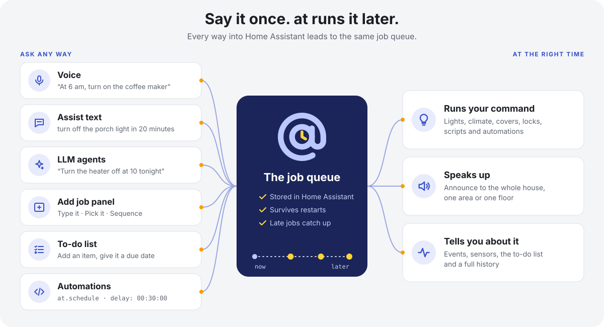

<picture>
  <source media="(prefers-color-scheme: dark)" srcset="docs/brand/logo-dark.svg">
  <source media="(prefers-color-scheme: light)" srcset="docs/brand/logo.svg">
  
</picture>

# at: Scheduled Jobs - Run any Home Assistant action later, once.

[![GitHub Release][releases-shield]][releases]
[![GitHub Activity][commits-shield]][commits]
[![License][license-shield]](LICENSE)

[![hacs][hacsbadge]][hacs]
![Project Maintenance][maintenance-shield]

**Tell Home Assistant what to do later, and it remembers.**

"Turn off the porch light at 11 pm." "Tomorrow at 6:30 turn on the coffee maker." "In 20 minutes, tell everyone downstairs dinner is ready." With `at`, those just work. You say or type a command the way you would say it now, add a time, and `at` keeps the job until it is due, through restarts, and then runs it once.

No helper entities to create, no throwaway automation to write and delete again, no timer that disappears when Home Assistant restarts. It is named after the Unix `at` command, which has done the same job on servers for decades.

<picture>
  <source media="(prefers-color-scheme: dark)" srcset="docs/brand/ways-to-schedule-dark.svg">
  <source media="(prefers-color-scheme: light)" srcset="docs/brand/ways-to-schedule.svg">
  
</picture>

## Just say when

`at` understands times the way people say them, before or after the command:

```text
turn on the porch light at 11 pm
at 6 am turn on the kitchen lights
close the garage door in 20 minutes
run the bedtime script in half an hour
turn off the TV on Friday at 6:30 pm
at 6 announce in the kitchen that dinner is ready
at 8 pm tell everyone upstairs it's time for bed
```

Clock times, words ("at seven thirty"), 24-hour time ("at eighteen hundred"), days ("tomorrow", "on Friday evening") and relative times ("in two and a half hours") all work. Ask "what's scheduled for tonight" to hear what is coming up, or say "cancel the porch light job" to change your mind.

## Six ways to schedule a job

| From                 | What it looks like                                                                                                              |
| -------------------- | ------------------------------------------------------------------------------------------------------------------------------- |
| 🎙️ **Voice**         | Speak to an Assist voice satellite or the companion app: "at 6 am turn on the coffee maker".                                    |
| ⌨️ **Assist text**   | Type the same sentence into the Assist dialog. No voice hardware needed.                                                        |
| ✨ **LLM agents**    | Conversation agents backed by an LLM get the `at__AtSchedule`, `at__AtList` and `at__AtCancel` tools, so they can schedule too. |
| 🗂️ **Sidebar panel** | The **Scheduled Jobs** panel lists what is coming up and what already ran, and **+ Add job** builds a job without a sentence.   |
| ✅ **To-do list**    | `todo.at_scheduled` shows every pending job. Add an item to schedule, change its due date to move it, check it off to run it.   |
| ⚙️ **Automations**   | The `at.schedule` action gives any automation or script a "do this later, once" step.                                           |

The **Add job** dialog has three ways in: **Type it** takes a sentence and shows what it understood, **Pick it** uses the same action form as the automation editor, and **Sequence** (administrators only) runs several steps in a row.

From an automation, "do this later" is one action:

```yaml
triggers:
  - trigger: state
    entity_id: binary_sensor.front_door
    to: "on"
actions:
  - action: at.schedule
    data:
      command: turn off the porch light
      delay: "00:30:00"
```

## Why you can rely on it

- **It does not forget.** Jobs are saved in Home Assistant's storage. A job that comes due while Home Assistant is restarting still runs if it is within the grace window (5 minutes by default), and is marked missed otherwise, so nothing fires hours late by surprise.
- **It checks before it promises.** A voice or text command is accepted only if Home Assistant's built-in agent understands it and the target is exposed to Assist. "Turn on the porch light" is checked against your real porch light when you schedule it, and again when it runs.
- **It stays out of the way.** Sentences `at` cannot use are handed back to the conversation agent you were talking to, so normal conversation keeps working. With an LLM agent, so are sentences naming a device or area `at` cannot find, which the LLM may still make sense of.
- **It respects who asked.** Anyone signed in can schedule a single action. Jobs with several steps or templates, and actions scheduled by an administrator or an automation, need an administrator to run early or change.
- **It tells you what happened.** Every job fires an event when it is scheduled, runs, fails, is cancelled or is missed, and shows in the logbook. `sensor.at_next_job` and `sensor.at_pending_jobs` put the queue on a dashboard.

> [!NOTE]
> Voice and text scheduling works in the languages that have a voice pack; see [Languages](docs/user/TRANSLATING.md#languages). Only commands that Home Assistant's built-in agent understands can be scheduled. See [known limitations](docs/user/CONFIGURATION.md#known-limitations).

## Installation

Search for **at: Scheduled Jobs** in the Marketplace (Home Assistant 2026.11 and newer) or in HACS, or open it directly:

[](https://my.home-assistant.io/redirect/hacs_repository/?owner=wonderslug&repository=ha-at&category=integration)

Then add the integration:

[](https://my.home-assistant.io/redirect/config_flow_start/?domain=at)

The setup asks for nothing, and only one instance can be added. Then say or type "turn on the porch light in 5 minutes" and watch the job appear in the **Scheduled Jobs** panel.

## At a glance

| Kind      | What `at` adds                                                                                      |
| --------- | --------------------------------------------------------------------------------------------------- |
| Panel     | **Scheduled Jobs** in the sidebar, with **Upcoming** and **History** tabs and an **Add job** dialog |
| Entities  | `todo.at_scheduled`, `sensor.at_next_job`, `sensor.at_pending_jobs`                                 |
| Actions   | `at.schedule`, `at.list`, `at.cancel`, `at.run_now`, `at.clear_history`                             |
| Events    | `at_job_scheduled`, `at_job_executed`, `at_job_failed`, `at_job_cancelled`, `at_job_missed`         |
| LLM tools | `at__AtSchedule`, `at__AtList`, `at__AtCancel`                                                      |

## Documentation

- [Getting started](docs/user/GETTING_STARTED.md): install, set up, first job, and removal
- [Configuration and reference](docs/user/CONFIGURATION.md): voice phrases, announcements, LLM agents, the panel, entities, actions, events, options, and known limitations
- [Examples](docs/user/EXAMPLES.md): automations and dashboards that use `at`

## Contributing

See [`docs/development/`](docs/development/) for the architecture and local setup.

---

## 📄 License

This project is licensed under the MIT License - see the [LICENSE](LICENSE) file for details.

---

**Made with ❤️ by [@wonderslug][user_profile]**

---

[commits-shield]: https://img.shields.io/github/commit-activity/y/wonderslug/ha-at.svg?style=for-the-badge
[commits]: https://github.com/wonderslug/ha-at/commits/main
[hacs]: https://www.hacs.xyz/docs/marketplace/
[hacsbadge]: https://img.shields.io/badge/HACS-Default-41BDF5.svg?style=for-the-badge
[license-shield]: https://img.shields.io/github/license/wonderslug/ha-at.svg?style=for-the-badge
[maintenance-shield]: https://img.shields.io/badge/maintainer-%40wonderslug-blue.svg?style=for-the-badge
[releases-shield]: https://img.shields.io/github/release/wonderslug/ha-at.svg?style=for-the-badge
[releases]: https://github.com/wonderslug/ha-at/releases
[user_profile]: https://github.com/wonderslug
